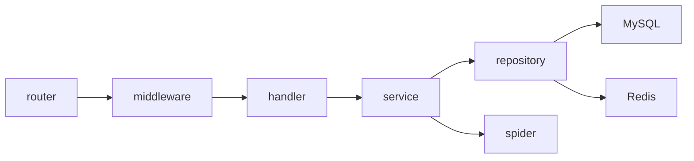
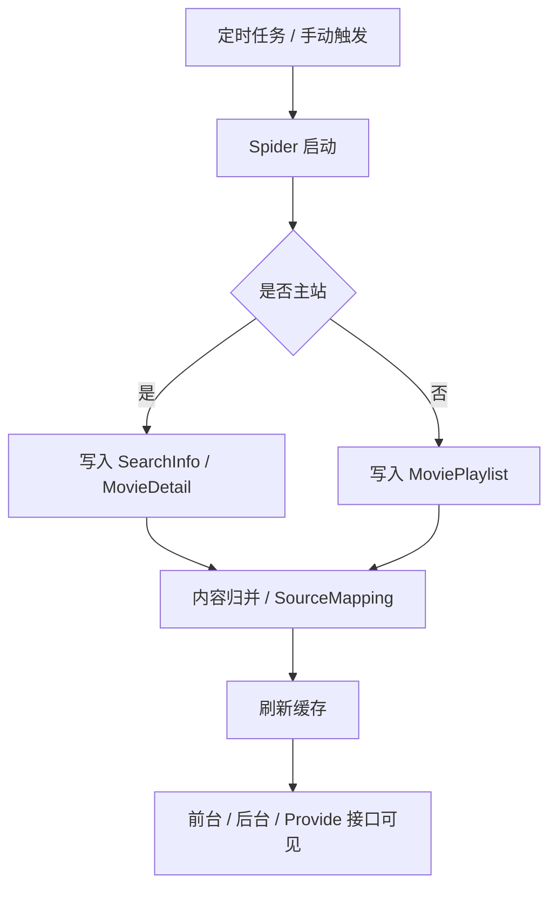
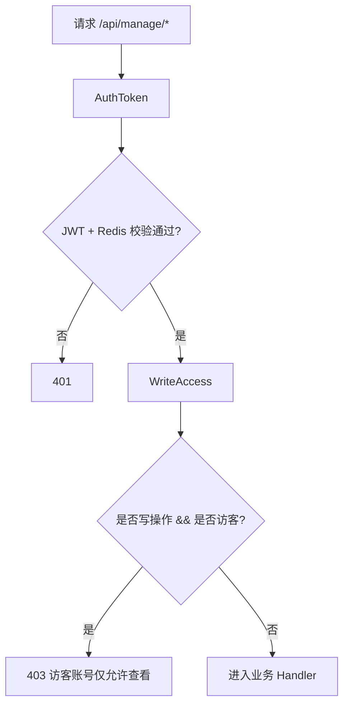

# Server

`server/` 是 Bracket-Film 的 Go 服务端，负责：

- 采集源管理与数据采集
- 影片检索、详情聚合、播放源聚合
- 分类映射与联动筛选
- 管理后台接口
- TVBox / MacCMS 兼容接口
- 登录态与后台鉴权

## 服务端架构



## 运行要求

- Go 1.24+
- MySQL 8+
- Redis 7+

## 本地启动

推荐直接使用项目内脚本：

```bash
cd server
./run-local.sh
```

脚本会：

- 加载 `server/.env`
- 执行 `go run ./cmd/server`

如果你想手动启动：

```bash
cd server
set -a
source .env
set +a
go run ./cmd/server
```

## 环境变量

本地运行使用 `server/.env`，Docker 运行使用根目录 `.env`。字段保持一致。

| 变量 | 必填 | 说明 |
| --- | --- | --- |
| `PORT` | 是 | 服务监听端口 |
| `JWT_SECRET` | 是 | JWT 签名密钥，未配置会直接启动失败 |
| `MYSQL_HOST` | 是 | MySQL 地址 |
| `MYSQL_PORT` | 是 | MySQL 端口 |
| `MYSQL_USER` | 是 | MySQL 用户 |
| `MYSQL_PASSWORD` | 否 | MySQL 密码 |
| `MYSQL_DBNAME` | 是 | 业务库名 |
| `REDIS_HOST` | 是 | Redis 地址 |
| `REDIS_PORT` | 是 | Redis 端口 |
| `REDIS_PASSWORD` | 否 | Redis 密码 |
| `REDIS_DB` | 否 | Redis DB，默认 `0` |
| `ENV` | 否 | 设置为 `dev` 时启用开发模式 |
| `IS_DEV_MODE` | 否 | 设置为 `true` 时同样启用开发模式 |

### 开发模式说明

`ENV=dev` 或 `IS_DEV_MODE=true` 时：

- 启动时会清空 Redis
- 启动时会尝试重建数据库
- 如果当前数据库账号没有足够权限，会明确报错退出

这适合本地调试，不适合保留数据的环境。

## 启动后初始化

服务首次启动会自动执行：

- 数据表自动迁移
- 默认内置账号初始化
- 默认站点配置初始化
- 默认定时任务初始化
- 分类映射与缓存预热

当前内置账号：

- 访客只读：`guest / guest`

管理员账号不在公开文档中暴露，请在部署后自行管理并及时修改默认口令。

## 采集流程



## 接口分层

### 公共接口

这类接口不要求登录：

- `/api/index`
- `/api/navCategory`
- `/api/filmDetail`
- `/api/filmPlayInfo`
- `/api/searchFilm`
- `/api/filmClassify`
- `/api/filmClassifySearch`
- `/api/proxy/video`
- `/api/provide/vod`
- `/api/provide/config`

### 登录相关接口

- `POST /api/login`
- `POST /api/logout`

其中 `/api/logout` 需要已登录。

### 后台接口

`/api/manage/*` 全部挂载了鉴权中间件，包括：

- 站点配置
- 轮播管理
- 用户管理
- 采集源管理
- 失败记录
- 定时任务
- 影片管理
- 文件管理

> 当前实现里，`/api/manage/*` 同时挂了登录鉴权和写权限控制。访客账号可以读，但不能写。

## 鉴权模型

当前后台鉴权流程如下：

1. `POST /api/login` 登录成功
2. 后端下发 `HttpOnly` cookie：`bracket_auth_token`
3. `/api/manage/*` 由后端中间件校验 cookie 中的 JWT
4. JWT 通过后，还会继续校验 Redis 中保存的当前有效 token

这意味着：

- 前端不再维护 localStorage token
- 后端是唯一真实鉴权边界
- 账号在其他设备重新登录后，旧 token 会失效

## 后台权限流



## 主要目录

```text
server/
├── cmd/server/             # 入口
├── internal/config/        # 配置与常量
├── internal/router/        # 路由
├── internal/middleware/    # CORS / JWT
├── internal/handler/       # HTTP 处理层
├── internal/service/       # 业务逻辑
├── internal/repository/    # 数据访问层
├── internal/model/         # 数据模型与 DTO
├── internal/spider/        # 采集与转换
├── internal/infra/db/      # MySQL / Redis 初始化
└── internal/utils/         # 工具函数
```

## 常用开发命令

```bash
cd server
go test ./...
```

如果本地 Go 缓存目录受限，可显式指定：

```bash
cd server
GOCACHE=/tmp/bracket-film-go-cache go test ./...
```

## 相关文档

- [根目录说明](../README.md)
- [前端说明](../web/README.md)
- [Docker 部署说明](../README-Docker.md)
- [FAQ 与排障](../README-FAQ.md)
